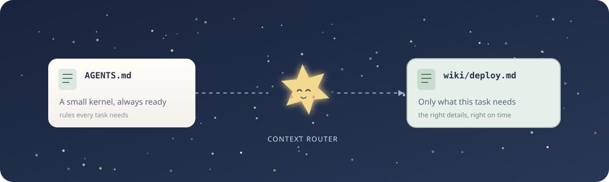
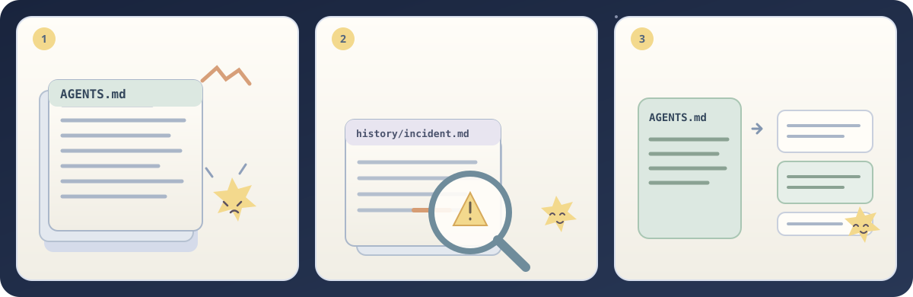
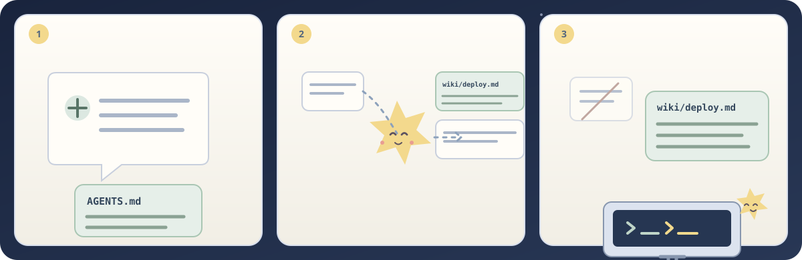

# agents-context-router

[English](README.md) | **日本語** | [한국어](README.ko.md) | [简体中文](README.zh-CN.md) | [繁體中文](README.zh-TW.md)

エージェント向けの指示は短く。プロジェクトの詳細は、必要なタスクでだけ読み込みます。

`agents-context-router` は、肥大化した `AGENTS.md` を小さな共通ルールとタスク別の wiki トピックに整理するスキルです。軽量な Python スクリプトで選んだトピックだけを表示し、履歴は毎回のコンテキストに含めずに保管できます。

<p align="center">
  
</p>

## 仕組み

すべてのタスクに必要なルールは `AGENTS.md` に残します。手順書やリファレンスはトピックページへ、日付付きの記録は履歴へ移します。エージェントは共通ルールを読んで該当トピックを選び、その内容だけを読み込みます。

<p align="center">
  
</p>

<p align="center">
  
</p>

## できること

- 常時読み込まれる指示ファイルの分割前後のサイズを計測。
- 内容を共通ルール、タスク別トピック、履歴、人向けドキュメントに分類。
- `wiki/ai-context.json` で、トピックとファイル全体または正確な見出しを対応付け。
- 依存関係のない `scripts/ai-context.py` を同梱。`list`、トピック表示、`check` に対応。
- バイト数の上限、見出しの欠落や重複、一覧にないトピック、参照されない wiki／履歴ファイルを検査。
- スキルを削除した後もルーターを保守できるよう、リポジトリ内のガイドを追加。

標準の上限はルート指示ファイルが 8 KiB、各トピックが 16 KiB です。トピックが大きくなったら上限を上げずに分割します。

## インストール

### Claude Code プラグイン

Claude Code のセッション内で実行します。

```text
/plugin marketplace add runkids/agents-context-router
/plugin install agents-context-router@agents-context-router
```

### Codex プラグイン

Codex のマーケットプレイスを追加し、`/plugins` を開いて **agents-context-router** をインストールします。

```bash
codex plugin marketplace add runkids/agents-context-router --sparse .agents/plugins
codex
```

### Antigravity

Antigravity CLI でプラグインをインストールします。

```bash
agy plugin install https://github.com/runkids/agents-context-router
```

ルートの `plugin.json` が同じスキルを公開するため、追加設定は不要です。同じコマンドを再実行すると更新できます。

### Skillshare

[Skillshare](https://github.com/runkids/skillshare) を使っていますか？通常のスキルとしてインストールし、すべてのターゲットへ同期できます。

```bash
skillshare install runkids/agents-context-router --global
skillshare sync
```

または、完全なネイティブプラグインとして、ほかのエージェント用プラグインと一緒に Claude Code と Codex へインストールして同期できます。

```bash
skillshare plugin add runkids/agents-context-router \
  --plugin agents-context-router \
  --target claude --target codex --global
skillshare sync plugins
```

Skillshare なら複数のネイティブプラグインをまとめて管理でき、エージェントごとのインストール状況も確認できます。[プラグインのコマンドガイド](https://skillshare.runkids.cc/docs/reference/commands/plugin/)を参照してください。

### Pi

Pi は `package.json` からスキルを直接読み込みます。拡張機能や起動フックは不要です。

```bash
pi install git:github.com/runkids/agents-context-router
```

公開済みのバージョンを固定するには、Git ソースの末尾に `@vX.Y.Z` を付け、`vX.Y.Z` を実在するタグに置き換えてください。更新時も固定したタグが維持されます。

### Hermes / Kimi Code / Muse

このリポジトリには、ほかのエージェント向けのネイティブ manifest も入っています。

```bash
# Hermes Agent
hermes plugins install runkids/agents-context-router --enable

# Muse
git clone https://github.com/runkids/agents-context-router.git
muse plugins install ./agents-context-router
muse plugins approve agents-context-router
```

```text
# Kimi Code
/plugins install https://github.com/runkids/agents-context-router
```

### その他のスキル対応エージェント

[Vercel Skills CLI](https://github.com/vercel-labs/skills) でスキルとしてインストールできます。

```bash
npx skills add runkids/agents-context-router
```

## バージョン

パッケージ、各ネイティブプラグイン、スキル、付属のルーターは同じバージョンを使います。公開済みバージョンには Git タグと[リリースノート](https://github.com/runkids/agents-context-router/releases)があります。貢献とリリースの手順は[リリースガイド](docs/releasing.md)を参照してください。

プロジェクトにコピーしたルーターは元のバージョンを保持します。`python3 scripts/ai-context.py --version` で確認でき、スキルを更新しても既存のコピーは置き換わりません。

## 使い方

エージェント向けドキュメントが大きくなったリポジトリで、次のように依頼します。

> 「`AGENTS.md` が大きすぎます。小さな共通ルールとタスク別の wiki トピックに分けてください。」

スキルは現状のコンテキスト量を計測し、ドキュメントを整理してルーターを設定し、結果を検査します。重複した `CLAUDE.md` のルールも整理し、マイルストーン記録は元の言語のまま保管します。

整理後は、そのリポジトリで次のコマンドを使えます。

```bash
python3 scripts/ai-context.py list
python3 scripts/ai-context.py debugging
python3 scripts/ai-context.py check
```

`list` は利用できるトピックを表示します。トピック名を指定すると、対応するセクションだけを元ファイルのパス付きで表示します。`check` はルーターと設定された上限を検証します。

`check` が検証するのは構造であり、事実の正確さやポリシーへの適合ではありません。特定タスクの教訓は topic に置き、すべてのタスクで必要な規則だけを kernel に含めます。生成される保守マニュアルでは、根拠と状態の記録、元資料の確認、変更した記述に絞ったレビューを説明します。

リポジトリ内に `scripts/` ディレクトリを置かず、リポジトリ外にインストールした 1 つのスクリプトを使うこともできます。

```bash
AI_CONTEXT_ROOT=/work/repo AI_CONTEXT_CONFIG=/work/settings/router.json \
  python3 /opt/tools/ai-context.py check
```

`list` とトピックのコマンドでも同じ環境を使い、カーネルのコンテキスト読み込みコマンドと検証フックに記録してください。上書き指定がなければ、ルートはスクリプトの 2 階層上のディレクトリ、設定ファイルは `<root>/wiki/ai-context.json` です。`/work/repo/scripts/ai-context.py` を指す `~/.local/bin/ai-context` のように、`scripts/` ディレクトリの外にあり、リンク側の 2 階層上に `wiki/ai-context.json` がないシンボリックリンクは、`AI_CONTEXT_CONFIG` が未設定ならリンク先の 2 階層上をルートにします。変わるのは設定ファイルがなく失敗していた実行だけで、`scripts/` 内のシンボリックリンクはそのリポジトリのコピーとしてリンク側のルートを維持します。`AI_CONTEXT_ROOT` だけを指定すると、そのリポジトリのデフォルト設定を使います。`AI_CONTEXT_CONFIG` だけなら、スクリプトの位置から求めたルートを維持します。上書き指定が空または未設定の場合はデフォルトを使います。

どちらのパスも正規化されます。明示的に指定した相対パスは、それぞれコマンド実行時のカレントディレクトリを基準に解決されます。`/work` からルートに `repo`、設定に `settings/router.json` を指定すると、`/work/repo` と `/work/settings/router.json` を選びます。外部の設定ファイルを使う場合も、JSON 内の相対パスは選択したルートを基準に解決されます。スクリプトは `~` やシェル変数を展開しません。絶対パスを使うか、シェルで展開してください。

意図的にルーティングしないファイルは、理由を添えて `"unrouted"` に完全一致のパスまたは fnmatch の glob として指定します。たとえば、`"projects/*/AGENTS.md": "Agents load these scoped instructions by cwd."` は該当ファイルを検査対象から除外します。照合では大文字と小文字を区別し、キー内のバックスラッシュは `/` に正規化されます。`*`、`?`、角括弧の文字クラスは Python の fnmatch の仕様に従います。`*` は `/` をまたぐため、この例は `projects/team/api/AGENTS.md` にも一致します。`**` に特別な再帰の意味はありません。ファイルの存在に関係なく、キーは自身に一致し、同時にパターンとしても働きます。`wiki/file[1].md` は自身と `wiki/file1.md` の両方を除外します。`wiki/file1.md` を除外せずに、角括弧を文字どおり含むファイル名を除外するには、`wiki/file[[]1].md` を使います。一致しない未ルーティングのファイルがあれば、引き続き `check` は失敗します。

生成物や証跡のダンプなど、指示を含まない大きなツリーは `"skipDirs": ["projects/*/artifacts"]`（デフォルト `[]`）で `check` の走査対象から外せます。各要素はリポジトリ相対のディレクトリの完全一致パス、または大文字と小文字を区別する fnmatch の glob で、`"unrouted"` のキーと同じように照合されます（`*` は `/` をまたぎます）。一致したディレクトリには `check` が入らないため、トピックのソースや明示したルーター索引でない限り、その中のページは孤立、indexed、リンクの検査対象になりません。各所有ルートの wiki は走査されますが、マウントのツリーは外側の走査から除外され、独自に検査されます。

## 既存のルーターツリー

プロジェクト内にある独立したルーターを利用するには、選択中の外側の設定に次のフィールドを追加します。

```json
"mounts": {
  "kb": { "root": "modules/kb-core" }
}
```

内側の設定は既定で `wiki/ai-context.json` です。任意の `"config": "context/router.json"` で、そのルート内の別ファイルを指定できます。プロジェクトで選択したスクリプトと環境を使います。

```bash
python3 scripts/ai-context.py list
python3 scripts/ai-context.py build-deploy kb/guide
python3 scripts/ai-context.py check
```

`list` には `[modules/kb-core]` 付きの `kb/guide` が追加され、出力コメントは外側のルートからのソースパスを示します。モジュールは接頭辞のない `guide` と自身の設定・指示・索引を保持します。外側の表にはローカルトピックだけを載せ、マウントは `list` で見つけます。`check` は各ルート自身の発見用の記述、バイト上限、孤立・履歴・indexed・リンクの規則と例外を使います。トピックのサイズは元のソースコメントを含むルート本来の出力で測るため、表示用の長い接頭辞で上限を超えることはありません。カーネルの前後の空白も測定に含めます。超過時は上限を上げず分割します。

マウント名は単一セグメントで、スラッシュ・バックスラッシュ・空白・制御文字・`.`・`..` は使えません。利用できない場合も `kb/` はローカルトピックとの衝突を防ぐため予約されます。ローカルの `kb` や内側の `ops/guide` は使えます。ルートはシンボリックリンク解決後も外側の厳密な子孫である必要があります。設定・指示・ソース・相対リンク・走査は各所有ルート内に収まり、内部の絶対パスや別名は使えます。相対ルートは選択中の外側のルート、設定と文書は内側のルートが基準です。cwd や設定ファイルの場所は基準にならず、`~` や変数も展開しません。内側の `mounts` は省略または空にします。既存データを読むだけで、取得やモジュールのスクリプト実行は行いません。

外側の孤立・indexed・wiki リンクの自動走査は、外側の wiki 内にある場合や内側の設定が不正な場合も、マウントの物理ツリーと別名を除外します。明示した外側のソースとルーター索引は検査されます。内部のルートが見つからない場合、`list` はパス付き `NOTICE` を1件出し、他のエラーがなければ終了コード0です。`check` と指定したマウントトピックは失敗します。不正な宣言・設定、外部ルート、入れ子はエラーですが、list/check は正常な項目を続けます。トピック要求は選択したマウントの設定だけを読み、すべての名前と本文が成功するまで何も出力しません。check の最後は1件の `ok` または失敗ルート数です。

mounts の省略と空オブジェクトは従来の単一ルート動作を保ちます。完全な契約はリポジトリ内の保守ガイドを参照してください。コピー済みの古いスクリプトは、ローカルの変更を比較してから意図的に更新します。スキルの更新だけでは置き換わりません。プロジェクトの設定・文書を保持し、`--version` で選択中のコピーを確認します。

## リポジトリ構成

```text
AGENTS.md                 常時読み込むルールとトピック一覧
wiki/ai-context.json      トピックとドキュメントの対応表
scripts/ai-context.py     トピック表示とドキュメント検査
wiki/<topic>.md           タスク別ガイドと手順書
wiki/history/*.md         通常のコンテキストに含めない日付付き記録
wiki/README.md            人向けのトピック・履歴一覧
```

同梱スクリプトは Python 標準ライブラリのみを使います（Python 3.8 以降）。例では `python3` を使っています。Windows では `python` または `py -3` を使ってください。スキルがルーターの導入時に適切なコマンドを選びます。正確な見出しを参照し、見出しがない場合や重複している場合は失敗するため、名前変更後に誤った指示が読み込まれることはありません。

## コントリビュート

Issue と Pull Request を歓迎します。スキルの手順と eval 用プロンプトは [`skills/agents-context-router/`](skills/agents-context-router/) にあります。

保守用の `agents-context-router-code-review` と `agents-context-router-release` は Skillshare の project mode で管理します。`skillshare install -p`、`skillshare sync -p` を実行すると `universal` と `claude` に同期されます。[レビューガイド](docs/review.md)と[リリースガイド](docs/releasing.md)を参照してください。この2つのスキルは公開用のルータースキルには含まれません。

## ライセンス

MIT

---

エージェントのコンテキスト整理に役立ったら、⭐ を付けてほかの開発者にもこのプロジェクトを知らせてください。
