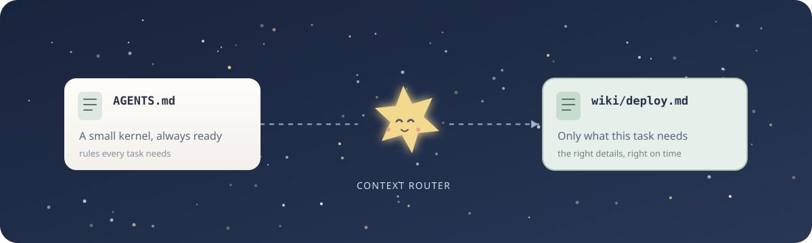
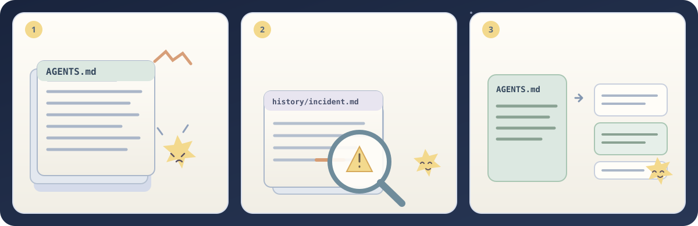
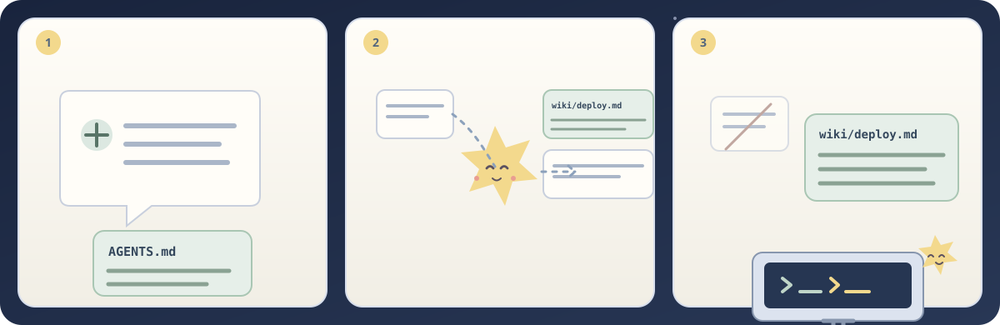

# agents-context-router

[English](README.md) | [日本語](README.ja.md) | **한국어** | [简体中文](README.zh-CN.md) | [繁體中文](README.zh-TW.md)

에이전트 지침은 짧게 유지하고, 프로젝트 세부 정보는 필요한 작업에서만 불러오세요.

`agents-context-router`는 비대해진 `AGENTS.md`를 작은 공통 규칙(kernel)과 작업별 wiki topic으로 정리하는 스킬입니다. 가벼운 Python 스크립트로 선택한 topic만 출력하고, 기록은 매 작업의 context에 넣지 않고 보관합니다.

<p align="center">
  
</p>

## 작동 방식

모든 작업에 필요한 규칙은 `AGENTS.md`에 둡니다. runbook과 참고 자료는 topic 페이지로, 날짜가 있는 기록은 history로 옮깁니다. 에이전트는 공통 규칙을 읽고 맞는 topic을 골라 그 내용만 불러옵니다.

<p align="center">
  
</p>

<p align="center">
  
</p>

## 주요 기능

- 분할 전후에 항상 로드되는 지침 파일의 크기를 측정합니다.
- 내용을 공통 규칙, 작업별 topic, history, 사용자 문서로 분류합니다.
- `wiki/ai-context.json`에서 topic을 파일 전체 또는 정확한 Markdown 제목에 연결합니다.
- 의존성이 없는 `scripts/ai-context.py`를 포함하며 `list`, topic 출력, `check`를 지원합니다.
- 바이트 예산, 누락되거나 중복된 제목, 목록에 없는 topic, 연결되지 않은 wiki/history 파일을 검사합니다.
- 스킬을 제거한 뒤에도 router를 유지할 수 있도록 저장소 안에 관리 가이드를 추가합니다.

기본 예산은 루트 지침 파일 8 KiB, topic별 16 KiB입니다. topic이 한도를 넘으면 한도를 올리는 대신 나누세요.

## 설치

### Claude Code 플러그인

Claude Code 세션에서 실행하세요.

```text
/plugin marketplace add runkids/agents-context-router
/plugin install agents-context-router@agents-context-router
```

### Codex 플러그인

Codex 플러그인 마켓플레이스를 추가한 다음 `/plugins`를 열고 **agents-context-router**를 설치하세요.

```bash
codex plugin marketplace add runkids/agents-context-router --sparse .agents/plugins
codex
```

### Antigravity

Antigravity CLI로 플러그인을 설치합니다.

```bash
agy plugin install https://github.com/runkids/agents-context-router
```

루트의 `plugin.json`이 같은 skill을 제공하므로 추가 설정은 필요하지 않습니다. 같은 명령을 다시 실행하면 업데이트됩니다.

### Skillshare

[Skillshare](https://github.com/runkids/skillshare)를 이미 사용 중인가요? 일반 스킬로 설치하고 모든 타깃에 동기화할 수 있습니다.

```bash
skillshare install runkids/agents-context-router --global
skillshare sync
```

또는 완전한 네이티브 플러그인으로 설치해 다른 에이전트 플러그인과 함께 Claude Code와 Codex에 동기화할 수도 있습니다.

```bash
skillshare plugin add runkids/agents-context-router \
  --plugin agents-context-router \
  --target claude --target codex --global
skillshare sync plugins
```

Skillshare로 여러 네이티브 플러그인을 한곳에서 관리하고 에이전트별 설치 상태를 확인하세요. [플러그인 명령 가이드](https://skillshare.runkids.cc/docs/reference/commands/plugin/)를 참고하세요.

### Pi

Pi는 `package.json`에서 skill을 직접 불러옵니다. extension이나 시작 hook은 필요하지 않습니다.

```bash
pi install git:github.com/runkids/agents-context-router
```

공개된 버전을 고정하려면 Git 소스 뒤에 `@vX.Y.Z`를 붙이고 `vX.Y.Z`를 실제 태그로 바꾸세요. 업데이트해도 고정한 태그는 유지됩니다.

### Hermes / Kimi Code / Muse

이 저장소에는 다른 에이전트용 네이티브 manifest도 들어 있습니다.

```bash
# Hermes Agent
hermes plugins install runkids/agents-context-router --enable

# Muse
git clone https://github.com/runkids/agents-context-router.git
muse plugins install ./agents-context-router
muse plugins approve agents-context-router
```

```text
# Kimi Code
/plugins install https://github.com/runkids/agents-context-router
```

### 기타 스킬 호환 에이전트

[Vercel Skills CLI](https://github.com/vercel-labs/skills)로 스킬을 설치할 수 있습니다.

```bash
npx skills add runkids/agents-context-router
```

## 버전

패키지, 네이티브 플러그인, skill과 함께 제공되는 router는 같은 버전을 사용합니다. 공개된 버전에는 Git 태그와 [릴리스 노트](https://github.com/runkids/agents-context-router/releases)가 있습니다. 기여 및 릴리스 절차는 [릴리스 가이드](docs/releasing.md)를 참고하세요.

프로젝트에 복사한 router는 원본 버전을 유지합니다. `python3 scripts/ai-context.py --version`으로 확인할 수 있으며, skill을 업데이트해도 기존 복사본은 바뀌지 않습니다.

## 사용법

에이전트 지침이 너무 커진 저장소에서 다음과 같이 요청하세요.

> “우리 `AGENTS.md`가 너무 커요. 작은 공통 규칙과 작업별 wiki topic으로 나눠 주세요.”

스킬은 현재 context를 측정하고 문서를 정리한 다음 router를 연결하고 결과를 검사합니다. 겹치는 `CLAUDE.md` 규칙도 다루며 마일스톤 기록은 원래 언어 그대로 보존합니다.

정리한 뒤에는 해당 저장소에서 다음 명령을 사용할 수 있습니다.

```bash
python3 scripts/ai-context.py list
python3 scripts/ai-context.py debugging
python3 scripts/ai-context.py check
```

`list`는 사용 가능한 topic을 보여 줍니다. topic 이름을 지정하면 해당 부분만 원본 경로와 함께 출력합니다. `check`는 router와 설정된 한도를 검증합니다.

저장소 안에 로컬 `scripts/` 디렉터리를 두지 않고, 저장소 밖에 설치한 스크립트 하나를 사용할 수도 있습니다.

```bash
AI_CONTEXT_ROOT=/work/repo AI_CONTEXT_CONFIG=/work/settings/router.json \
  python3 /opt/tools/ai-context.py check
```

`list`와 topic 명령에도 같은 환경을 사용하고, 커널의 context 로드 명령과 검증 훅에 기록하세요. 재정의하지 않으면 루트는 스크립트의 두 단계 상위 디렉터리이며, 설정 파일은 `<root>/wiki/ai-context.json`입니다. `/work/repo/scripts/ai-context.py`를 가리키는 `~/.local/bin/ai-context`처럼 `scripts/` 디렉터리 밖에 있고 링크 쪽 두 단계 상위에 `wiki/ai-context.json`이 없는 심볼릭 링크는, `AI_CONTEXT_CONFIG`가 설정되지 않았다면 링크 대상의 두 단계 상위를 루트로 사용합니다. 설정 파일이 없어 실패하던 실행만 달라지며, `scripts/` 안의 심볼릭 링크는 해당 저장소의 복사본으로 보고 링크 쪽 루트를 유지합니다. `AI_CONTEXT_ROOT`만 지정하면 해당 저장소의 기본 설정을 사용합니다. `AI_CONTEXT_CONFIG`만 지정하면 스크립트 위치에서 구한 루트를 유지합니다. 재정의 값이 비어 있거나 설정되지 않으면 기본값을 사용합니다.

두 경로 모두 정규화됩니다. 명시적으로 지정한 상대 경로는 각각 명령을 실행하는 현재 작업 디렉터리를 기준으로 해석됩니다. `/work`에서 루트를 `repo`, 설정을 `settings/router.json`으로 지정하면 `/work/repo`와 `/work/settings/router.json`을 선택합니다. 외부 설정 파일을 사용해도 JSON 안의 상대 경로는 선택한 루트를 기준으로 해석됩니다. 스크립트는 `~`나 셸 변수를 확장하지 않습니다. 절대 경로를 사용하거나 셸에서 확장하세요.

의도적으로 라우팅하지 않는 파일은 이유와 함께 `"unrouted"`에 정확한 경로 또는 fnmatch glob으로 지정합니다. 예를 들어 `"projects/*/AGENTS.md": "Agents load these scoped instructions by cwd."`는 해당 파일을 검사 대상에서 제외합니다. 일치는 대소문자를 구분하며, 키 안의 백슬래시는 `/`로 정규화됩니다. `*`, `?`, 대괄호 문자 클래스는 Python fnmatch의 의미를 따릅니다. `*`는 `/`를 넘어서도 일치하므로 이 예시는 `projects/team/api/AGENTS.md`에도 일치합니다. `**`에는 특별한 재귀 의미가 없습니다. 파일의 존재 여부와 관계없이 키는 자기 자신과 일치하면서 패턴으로도 작동합니다. `wiki/file[1].md`는 자신과 `wiki/file1.md`를 모두 제외합니다. `wiki/file1.md`를 제외하지 않고 대괄호가 문자 그대로 포함된 파일 이름을 제외하려면 `wiki/file[[]1].md`를 사용하세요. 일치하지 않는 미라우팅 파일이 있으면 여전히 `check`가 실패합니다.

생성된 출력물이나 증거 덤프처럼 지침이 없는 큰 트리는 `"skipDirs": ["projects/*/artifacts"]`(기본값 `[]`)로 `check`의 탐색에서 제외할 수 있습니다. 각 항목은 저장소 기준 디렉터리의 정확한 경로이거나 대소문자를 구분하는 fnmatch glob이며, `"unrouted"` 키와 같은 방식으로 일치시킵니다(`*`는 `/`를 넘어 일치합니다). `check`는 일치하는 디렉터리에 들어가지 않으므로, topic 소스나 명시한 router 색인이 아닌 한 그 안의 페이지는 고아, indexed, 링크 검사를 받지 않습니다. 각 소유 루트의 wiki는 탐색하지만 마운트 트리는 바깥쪽 탐색에서 제외하고 독립적으로 검사합니다.

## 기존 router 트리

프로젝트 안에 이미 있는 독립 router를 사용하려면 선택한 바깥쪽 설정에 다음 필드를 추가하세요.

```json
"mounts": {
  "kb": { "root": "modules/kb-core" }
}
```

안쪽 설정은 기본적으로 `wiki/ai-context.json`입니다. 선택 사항인 `"config": "context/router.json"`으로 해당 루트 안의 다른 파일을 지정할 수 있습니다. 프로젝트에서 선택한 스크립트와 환경을 사용하세요.

```bash
python3 scripts/ai-context.py list
python3 scripts/ai-context.py build-deploy kb/guide
python3 scripts/ai-context.py check
```

`list`는 `[modules/kb-core]` 출처와 함께 `kb/guide`를 추가하고, 출력 주석에는 바깥쪽 루트 기준 소스 경로가 표시됩니다. 모듈은 접두사 없는 `guide`와 자체 설정·지침·색인을 유지합니다. 바깥쪽 표에는 로컬 topic만 적고 마운트는 `list`로 찾으세요. `check`는 각 루트의 발견용 지침, 바이트 한도, 고아·history·indexed·링크 규칙과 예외를 따릅니다. topic 크기는 원래 소스 주석을 포함한 자체 렌더링으로 측정하므로 긴 마운트 표시 경로가 모듈 한도를 늘리지 않습니다. 커널 텍스트의 앞뒤 공백도 측정합니다. 한도를 넘으면 높이지 말고 나누세요.

마운트 이름은 단일 경로 구간이며 슬래시, 백슬래시, 공백, 제어 문자, `.`과 `..`를 허용하지 않습니다. 사용할 수 없어도 `kb/`는 로컬 topic과 충돌하지 않도록 예약됩니다. 로컬 `kb`와 안쪽 `ops/guide`는 사용할 수 있습니다. 심볼릭 링크를 해석한 뒤에도 루트는 바깥쪽 루트의 엄격한 하위 디렉터리여야 합니다. 설정·지침·소스·상대 링크·탐색은 소유 루트 안에 머물며, 내부 절대 경로와 별칭은 허용됩니다. 상대 루트는 선택한 바깥쪽 루트, 설정과 문서는 안쪽 루트를 기준으로 해석합니다. cwd나 설정 파일 위치를 기준으로 하지 않으며 `~`와 변수도 확장하지 않습니다. 안쪽 `mounts`는 없거나 비어 있어야 합니다. 기존 데이터를 읽을 뿐 가져오거나 모듈 스크립트를 실행하지 않습니다.

바깥쪽 고아·indexed·wiki 링크 자동 탐색은 마운트의 물리 트리와 별칭을 제외합니다. 바깥쪽 wiki 아래에 있거나 안쪽 설정이 잘못되어도 마찬가지입니다. 명시한 바깥쪽 소스와 router 색인은 계속 검사합니다. 내부 루트가 없으면 `list`는 경로가 있는 `NOTICE` 하나를 출력하고, 다른 오류가 없을 때 종료 코드0을 반환합니다. `check`와 요청한 마운트 topic은 실패합니다. 잘못된 선언·설정, 외부 루트, 중첩은 오류지만 list/check는 정상 항목을 계속 처리합니다. topic 요청은 선택한 마운트 설정만 읽고, 모든 이름과 본문이 성공할 때까지 아무것도 출력하지 않습니다. check는 마지막에 `ok` 하나 또는 실패한 루트 수를 표시합니다.

mounts를 생략하거나 빈 객체로 두면 기존 단일 루트 동작을 유지합니다. 전체 규칙은 저장소 안의 관리 가이드를 참고하세요. 복사된 구버전 스크립트는 로컬 변경을 비교한 뒤 직접 업데이트해야 합니다. 설치된 skill만 업데이트해도 교체되지 않습니다. 프로젝트 설정·문서를 보존하고 `--version`으로 선택한 복사본을 확인하세요.

## 저장소 구조

```text
AGENTS.md                 항상 로드하는 규칙과 topic 목록
wiki/ai-context.json      topic과 문서의 매핑
scripts/ai-context.py     topic 출력 및 문서 검사
wiki/<topic>.md           작업별 가이드와 runbook
wiki/history/*.md         기본 context에서 제외되는 날짜별 기록
wiki/README.md            사람이 읽는 topic 및 기록 목록
```

포함된 스크립트는 Python 표준 라이브러리만 사용합니다(Python 3.8 이상).예시는 `python3`를 사용합니다. Windows에서는 `python` 또는 `py -3`를 사용하세요. 스킬이 라우터를 설치할 때 알맞은 명령을 고릅니다. 제목을 정확히 참조하며, 제목이 없거나 중복되면 실패하므로 제목이 바뀐 뒤 잘못된 지침이 조용히 로드되지 않습니다.

제목을 지정한 소스에 `"frontmatter": true`를 설정하면 문서 시작의 닫힌 frontmatter(`---`부터 `---` 또는 `...`까지)를 건너뛰며 YAML 유효성을 검사하지 않습니다.생략하거나 `false`이면 기존 제목 동작을 유지합니다. 전체 페이지 소스는 이를 유지하고, 닫는 구분자가 없으면 기존 Markdown 동작을 유지합니다. 정확한 경계 규칙은 관리 가이드를 참고하세요. OKF 검증이나 메타데이터 추가 출력 기능은 아닙니다.

## 기여

Issue와 Pull Request를 환영합니다. 스킬 절차와 eval 프롬프트는 [`skills/agents-context-router/`](skills/agents-context-router/)에 있습니다.

유지보수용 `agents-context-router-code-review`와 `agents-context-router-release`는 Skillshare project mode로 관리합니다. `skillshare install -p`, `skillshare sync -p`를 실행하면 `universal`과 `claude`에 동기화됩니다. [리뷰 가이드](docs/review.md)와 [릴리스 가이드](docs/releasing.md)를 참고하세요. 이 두 skill은 공개 router skill 번들에 포함되지 않습니다.

## 라이선스

MIT

---

에이전트 context를 정리하는 데 도움이 됐다면 ⭐를 눌러 더 많은 개발자가 이 프로젝트를 찾을 수 있게 해 주세요.
