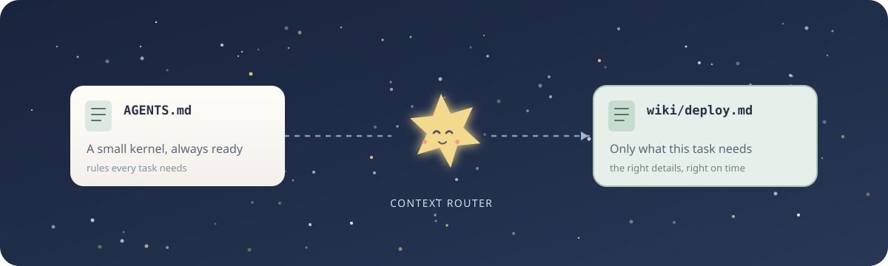
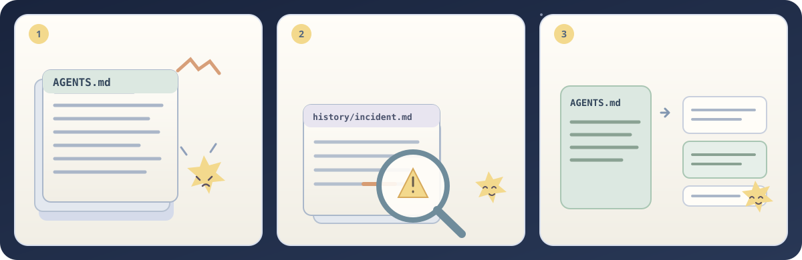
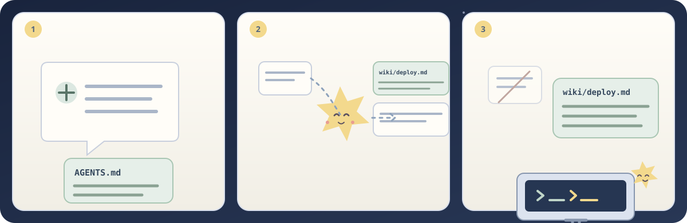

# agents-context-router

[English](README.md) | [日本語](README.ja.md) | [한국어](README.ko.md) | **简体中文** | [繁體中文](README.zh-TW.md)

让 Agent 指令保持精简，只在任务需要时加载项目资料。

`agents-context-router` 可以把臃肿的 `AGENTS.md` 整理成精简的共用规则，以及按任务加载的 wiki topic。轻量级 Python 脚本只输出选中的 topic；历史记录保留在仓库中，不会默认进入每次任务的上下文。

<p align="center">
  
</p>

## 工作方式

所有任务都需要的规则放在 `AGENTS.md`。操作手册和参考资料放入 topic 页面，带日期的记录放入 history。Agent 读取共用规则、选择相关 topic，然后只加载该 topic。

<p align="center">
  
</p>

<p align="center">
  
</p>

## 功能

- 测量拆分前后每次都会加载的指令文件大小。
- 将内容分类为共用规则、任务 topic、历史记录和面向人的文档。
- 通过 `wiki/ai-context.json` 将 topic 映射到完整文件或精确的 Markdown 标题。
- 内置无额外依赖的 `scripts/ai-context.py`，支持 `list`、topic 输出和 `check`。
- 检查字节数上限、缺失或重复的标题、未列出的 topic，以及未被路由的 wiki／history 文件。
- 在仓库内添加维护指南，方便移除 skill 后继续维护路由结构。

默认上限为根指令文件 8 KiB、每个 topic 16 KiB。topic 超限时应拆分，而不是调高上限。

## 安装

### Claude Code 插件

在 Claude Code 会话中运行：

```text
/plugin marketplace add runkids/agents-context-router
/plugin install agents-context-router@agents-context-router
```

### Codex 插件

添加仓库中的 Codex 插件市场，然后打开 `/plugins` 并安装 **agents-context-router**：

```bash
codex plugin marketplace add runkids/agents-context-router --sparse .agents/plugins
codex
```

### Antigravity

通过 Antigravity CLI 安装插件：

```bash
agy plugin install https://github.com/runkids/agents-context-router
```

根目录的 `plugin.json` 会提供同一份 skill，无需额外配置。再次执行相同命令即可更新。

### Skillshare

已经在用 [Skillshare](https://github.com/runkids/skillshare)？可以作为普通 skill 安装，并同步到所有 target：

```bash
skillshare install runkids/agents-context-router --global
skillshare sync
```

或者安装完整的原生插件，和其他 Agent 插件一起同步到 Claude Code 和 Codex：

```bash
skillshare plugin add runkids/agents-context-router \
  --plugin agents-context-router \
  --target claude --target codex --global
skillshare sync plugins
```

Skillshare 可以集中管理完整的原生插件，并查看各 Agent 的安装状态。参阅 [插件命令指南](https://skillshare.runkids.cc/docs/reference/commands/plugin/)。

### Pi

Pi 通过 `package.json` 直接加载 skill，不需要 extension 或启动 hook。

```bash
pi install git:github.com/runkids/agents-context-router
```

如需固定已发布的版本，在 Git 来源后加上 `@vX.Y.Z`，并将 `vX.Y.Z` 替换为已存在的 tag。更新时仍会保留固定的 tag。

### Hermes / Kimi Code / Muse

本仓库还包含其他 Agent 的原生 manifest：

```bash
# Hermes Agent
hermes plugins install runkids/agents-context-router --enable

# Muse
git clone https://github.com/runkids/agents-context-router.git
muse plugins install ./agents-context-router
muse plugins approve agents-context-router
```

```text
# Kimi Code
/plugins install https://github.com/runkids/agents-context-router
```

### 其他兼容 skill 的 Agent

使用 [Vercel Skills CLI](https://github.com/vercel-labs/skills) 安装：

```bash
npx skills add runkids/agents-context-router
```

## 版本

包、原生插件、skill 和附带的 router 共用同一版本。正式版本会有 Git tag 和[发行说明](https://github.com/runkids/agents-context-router/releases)。贡献与发布流程请参阅[发布指南](docs/releasing.md)。

复制到项目的 router 会保留来源版本，可用 `python3 scripts/ai-context.py --version` 查询；更新 skill 不会替换已有副本。

## 使用

在 Agent 文档已经膨胀的仓库中，告诉你的编程 Agent：

> “我们的 `AGENTS.md` 太大了。请把它拆成精简的共用规则和按任务加载的 wiki topic。”

Skill 会先测量现有上下文，再整理文档、配置路由并检查结果。它也会处理与 `AGENTS.md` 重叠的 `CLAUDE.md` 规则，并以原语言保留里程碑记录。

整理完成后，可在该仓库中运行：

```bash
python3 scripts/ai-context.py list
python3 scripts/ai-context.py debugging
python3 scripts/ai-context.py check
```

`list` 显示可用 topic。指定 topic 名称后，脚本只会输出映射的内容，并标注来源路径。`check` 会验证路由配置和所设上限。

也可以在仓库外安装一份共用脚本，无需在仓库内保留 `scripts/` 目录：

```bash
AI_CONTEXT_ROOT=/work/repo AI_CONTEXT_CONFIG=/work/settings/router.json \
  python3 /opt/tools/ai-context.py check
```

`list` 和 topic 命令也应使用相同的环境，并将其记录在核心规则的上下文加载命令和验证 hook 中。未指定覆盖值时，根目录是脚本所在目录的上一级，配置文件是 `<root>/wiki/ai-context.json`。通过 `scripts/` 目录之外的符号链接运行时（例如指向 `/work/repo/scripts/ai-context.py` 的 `~/.local/bin/ai-context`），如果链接所在目录的上一级没有 `wiki/ai-context.json`，且未设置 `AI_CONTEXT_CONFIG`，则以链接目标所在目录的上一级作为根目录。只有原本会因缺少配置而失败的运行才会改变；`scripts/` 目录内的符号链接视为该仓库的副本，保留链接自身的根目录。仅指定 `AI_CONTEXT_ROOT` 会选用该仓库的默认配置；仅指定 `AI_CONTEXT_CONFIG` 则保留从脚本位置推导的根目录。覆盖值为空或未设置时使用默认值。

这两个路径都会规范化。显式指定的相对路径分别基于命令调用时的当前工作目录解析：在 `/work` 中，将根目录设为 `repo`、配置设为 `settings/router.json`，会选用 `/work/repo` 和 `/work/settings/router.json`。即使配置文件在仓库外，JSON 内的相对路径仍基于选定的根目录解析。脚本不会展开 `~` 或 shell 变量；请使用绝对路径，或让 shell 展开它们。

有意保留的未路由文件例外应放在 `"unrouted"` 中，使用精确路径或 fnmatch glob，并为每项提供理由。例如，`"projects/*/AGENTS.md": "Agents load these scoped instructions by cwd."` 会豁免这些文件。匹配区分大小写，键中的反斜杠会规范化为 `/`。`*`、`?` 和方括号字符类遵循 Python fnmatch 语义：`*` 可以跨越 `/`，因此该示例也会匹配 `projects/team/api/AGENTS.md`；`**` 没有特殊的递归含义。无论文件是否存在，键既匹配自身，也作为模式参与匹配：`wiki/file[1].md` 会同时豁免自身和 `wiki/file1.md`。使用 `wiki/file[[]1].md` 可豁免带有字面方括号的文件名，而不会同时豁免 `wiki/file1.md`。未匹配到的未路由文件仍会导致 `check` 失败。

对于不含指令的大型目录树，例如生成的输出或证据转储，可用 `"skipDirs": ["projects/*/artifacts"]`（默认 `[]`）让 `check` 不再遍历它们。每项是相对仓库的目录精确路径或区分大小写的 fnmatch glob，匹配方式与 `"unrouted"` 的键相同（`*` 可跨越 `/`）。`check` 不会进入匹配的目录，因此除非页面列为 topic 的来源或选作 router 索引，这些页面不会参与孤立页面、indexed 和链接检查。每个根目录的 wiki 都会被遍历，但挂载目录树从外层扫描中排除，并接受独立检查。

`python3 scripts/ai-context.py --dedupe <topic> <topic>`: [opt-in exact-source reuse and its limits](README.md#combining-topics-without-repeating-exact-sources). Default and single-topic output, source markers, and independent `check` budgets are unchanged.

## 已有的 router 目录树

要使用项目内已经存在的独立 router，请在选中的外层配置中添加此字段：

```json
"mounts": {
  "kb": { "root": "modules/kb-core" }
}
```

内层配置默认为 `wiki/ai-context.json`；可选的 `"config": "context/router.json"` 可选择该根目录内的其他配置。使用项目选定的脚本和环境：

```bash
python3 scripts/ai-context.py list
python3 scripts/ai-context.py build-deploy kb/guide
python3 scripts/ai-context.py check
```

`list` 会追加带有 `[modules/kb-core]` 来源的 `kb/guide`，输出注释使用相对外层根目录的来源路径。模块保留不带前缀的 `guide`，以及自己的配置、指令和索引。外层表格只列本地 topic，挂载 topic 用 `list` 发现。`check` 分别使用每个根目录自己的发现规则、字节上限、孤立页面／history／indexed／链接规则和例外。topic 按根目录原生渲染的字节数计量，包含原生来源注释；更长的挂载显示路径不会增加模块的计量值。kernel 文本计量保留首尾空白。超限时拆分 topic，不提高上限。

挂载名必须是单一路径段，不含斜杠、反斜杠、空白、控制字符、`.` 或 `..`；即使不可用，`kb/` 仍会保留，禁止与本地 topic 冲突。本地 `kb` 和内层 `ops/guide` 仍然有效。解析符号链接后，挂载根目录必须严格位于外层根目录之下；配置、指令、来源、相对链接和扫描都不能越过自己的根目录。允许内部的绝对路径和别名。相对 root 以选中的外层根目录为基准，配置和文档以内层根目录为基准，与 cwd、配置文件位置无关；不展开 `~` 或变量。内层 `mounts` 必须省略或为空。只读取已有数据，不获取模块，也不执行模块脚本。

外层的孤立页面／indexed／wiki 链接自动扫描会排除挂载的物理目录树及别名，即使模块位于外层 wiki 中或内层配置无效。显式指定的外层来源与 router 索引仍会检查。内部根目录缺失时，`list` 输出一条带路径的 `NOTICE`，没有其他错误则返回状态0；`check` 和请求该挂载 topic 都会失败。无效声明／配置、越界目录和嵌套挂载是错误，但 list/check 会继续处理健康条目。topic 请求只读取所选挂载配置，所有名称和正文成功前不输出任何内容。check 最后只给出一个 `ok` 或失败根目录数。

省略 mounts 或使用空对象可保留原有单根目录行为；完整约定见仓库内维护手册。旧的脚本副本需要比较本地修改后主动更新，更新已安装 skill 不会自动替换它们。保留项目配置和文档，用 `--version` 确认所选副本。

## 仓库结构

```text
AGENTS.md                 每次加载的规则和 topic 索引
wiki/ai-context.json      topic 与文档的映射
scripts/ai-context.py     输出 topic 并检查文档
wiki/<topic>.md           任务指南和操作手册
wiki/history/*.md         不会默认载入上下文的日期记录
wiki/README.md            面向人的 topic 与历史索引
```

脚本只使用 Python 标准库（Python 3.8+）。示例使用 `python3`；在 Windows 上请改用 `python` 或 `py -3`。skill 会在安装 router 时选择合适的命令。标题引用必须精确匹配；标题缺失或重复时检查会失败，避免重命名后悄悄加载错误内容。

## 参与贡献

欢迎提交 Issue 和 Pull Request。Skill 工作流程和 eval 提示词位于 [`skills/agents-context-router/`](skills/agents-context-router/)。

维护用的 `agents-context-router-code-review` 和 `agents-context-router-release` 由 Skillshare project mode 管理。运行 `skillshare install -p`、`skillshare sync -p` 即可同步到 `universal` 和 `claude`；详见 [review 指南](docs/review.md)和[发布指南](docs/releasing.md)。这两个 skill 不包含在对外发布的 router skill 中。

## 许可证

MIT

---

如果它帮你减少了 Agent 的上下文负担，欢迎点个 ⭐，让更多开发者发现这个项目。
