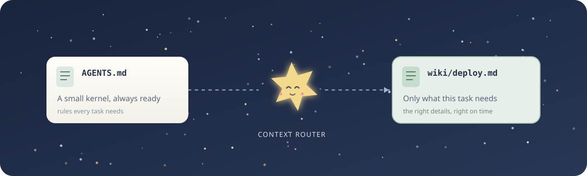
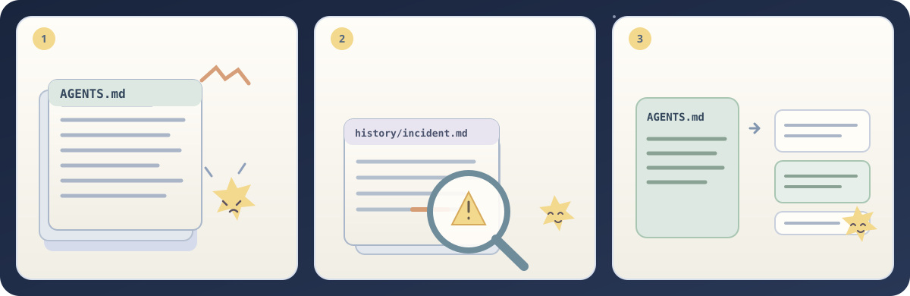
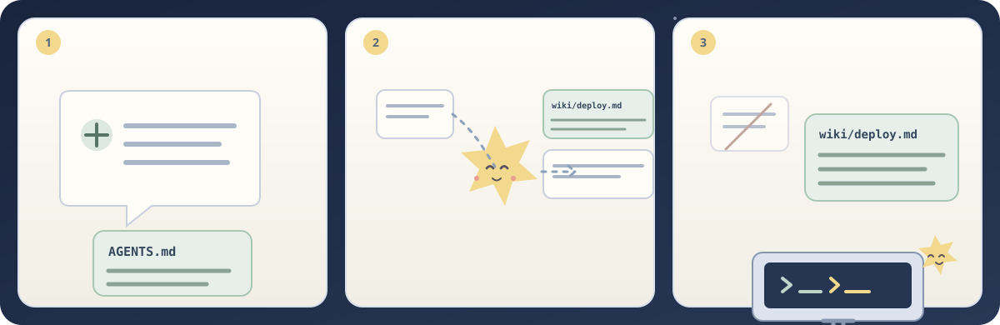

# agents-context-router

[English](README.md) | [日本語](README.ja.md) | [한국어](README.ko.md) | [简体中文](README.zh-CN.md) | **繁體中文**

讓 Agent 指令保持精簡，只在任務需要時載入專案資料。

`agents-context-router` 能把臃腫的 `AGENTS.md` 整理成精簡的共用規則，以及依任務載入的 wiki topic。輕量的 Python 腳本只輸出選定的 topic；歷史紀錄留在 repo 裡，不會預設載入每次任務的 context。

<p align="center">
  
</p>

## 運作方式

所有任務都需要的規則放在 `AGENTS.md`。操作手冊和參考資料放進 topic 頁面，有日期的紀錄放進 history。Agent 讀取共用規則、選擇相關 topic，再只載入該 topic。

<p align="center">
  
</p>

<p align="center">
  
</p>

## 功能

- 測量拆分前後，每次都會載入的指令文件大小。
- 將內容分類為共用規則、任務 topic、歷史紀錄和給人看的文件。
- 透過 `wiki/ai-context.json` 將 topic 對應到完整文件或精確的 Markdown 標題。
- 內含零額外依賴的 `scripts/ai-context.py`，支援 `list`、topic 輸出和 `check`。
- 檢查位元組數上限、遺失或重複的標題、未列出的 topic，以及未被路由的 wiki／history 文件。
- 在 repo 內加入維護指南，移除 skill 後仍能繼續維護路由。

預設上限是根目錄指令文件 8 KiB、每個 topic 16 KiB。topic 超出上限時應拆分，而不是調高上限。

## 安裝

### Claude Code plugin

在 Claude Code session 中執行：

```text
/plugin marketplace add runkids/agents-context-router
/plugin install agents-context-router@agents-context-router
```

### Codex plugin

加入 repo 裡的 Codex plugin marketplace，再開啟 `/plugins` 安裝 **agents-context-router**：

```bash
codex plugin marketplace add runkids/agents-context-router --sparse .agents/plugins
codex
```

### Antigravity

透過 Antigravity CLI 安裝 plugin：

```bash
agy plugin install https://github.com/runkids/agents-context-router
```

根目錄的 `plugin.json` 會提供同一份 skill，不需額外設定。再次執行相同指令即可更新。

### Skillshare

已經在用 [Skillshare](https://github.com/runkids/skillshare) 嗎？可以當作一般 skill 安裝，並同步到所有 target：

```bash
skillshare install runkids/agents-context-router --global
skillshare sync
```

或安裝完整的原生 plugin，和其他 Agent plugin 一起同步到 Claude Code 和 Codex：

```bash
skillshare plugin add runkids/agents-context-router \
  --plugin agents-context-router \
  --target claude --target codex --global
skillshare sync plugins
```

Skillshare 可集中管理完整的原生 plugin，並查看各 Agent 的安裝狀態。請參閱 [plugin 指令指南](https://skillshare.runkids.cc/docs/reference/commands/plugin/)。

### Pi

Pi 會透過 `package.json` 直接載入 skill，不需要 extension 或啟動 hook。

```bash
pi install git:github.com/runkids/agents-context-router
```

若要固定已發布的版本，在 Git 來源後加上 `@vX.Y.Z`，並將 `vX.Y.Z` 換成已存在的 tag。更新時仍會保留固定的 tag。

### Hermes / Kimi Code / Muse

本 repo 還包含其他 Agent 的原生 manifest：

```bash
# Hermes Agent
hermes plugins install runkids/agents-context-router --enable

# Muse
git clone https://github.com/runkids/agents-context-router.git
muse plugins install ./agents-context-router
muse plugins approve agents-context-router
```

```text
# Kimi Code
/plugins install https://github.com/runkids/agents-context-router
```

### 其他支援 skill 的 Agent

使用 [Vercel Skills CLI](https://github.com/vercel-labs/skills) 安裝：

```bash
npx skills add runkids/agents-context-router
```

## 版本

套件、原生 plugin、skill 與附帶的 router 共用同一版本。`0.0.0` 是尚未發布的初始基準；正式版本會有 Git tag 與[發行說明](https://github.com/runkids/agents-context-router/releases)。貢獻與發布流程請參閱[發版指南](docs/releasing.md)。

複製到專案的 router 會保留來源版本，可用 `python3 scripts/ai-context.py --version` 查詢；更新 skill 不會替換既有副本。

## 使用方式

在 Agent 文件已經很龐大的 repo，告訴你的 coding agent：

>「我們的 `AGENTS.md` 太大了，請拆成精簡的共用規則和依任務載入的 wiki topic。」

Skill 會先測量目前的 context，再整理文件、設定路由並檢查結果。它也會處理和 `AGENTS.md` 重複的 `CLAUDE.md` 規則，並以原本語言保留里程碑紀錄。

整理完成後，可在該 repo 執行：

```bash
python3 scripts/ai-context.py list
python3 scripts/ai-context.py debugging
python3 scripts/ai-context.py check
```

`list` 顯示可用的 topic。指定 topic 名稱後，腳本只會輸出對應內容，並標示來源路徑。`check` 會驗證路由和設定的上限。

也可以在儲存庫外安裝一份共用腳本，不必在儲存庫內保留 `scripts/` 目錄：

```bash
AI_CONTEXT_ROOT=/work/repo AI_CONTEXT_CONFIG=/work/settings/router.json \
  python3 /opt/tools/ai-context.py check
```

`list` 和 topic 指令也應使用相同的環境，並將其記錄在核心規則的 context 載入指令和驗證 hook 中。未指定覆寫值時，根目錄是腳本所在目錄的上一層，設定檔是 `<root>/wiki/ai-context.json`。透過 `scripts/` 目錄之外的符號連結執行時（例如指向 `/work/repo/scripts/ai-context.py` 的 `~/.local/bin/ai-context`），若連結所在目錄的上一層沒有 `wiki/ai-context.json`，且未設定 `AI_CONTEXT_CONFIG`，則以連結目標所在目錄的上一層作為根目錄。只有原本會因缺少設定檔而失敗的執行才會改變；`scripts/` 目錄內的符號連結視為該儲存庫的副本，保留連結本身的根目錄。只指定 `AI_CONTEXT_ROOT` 會選用該儲存庫的預設設定；只指定 `AI_CONTEXT_CONFIG` 則保留從腳本位置推導的根目錄。覆寫值為空或未設定時使用預設值。

這兩個路徑都會正規化。明確指定的相對路徑會各自以呼叫指令時的目前工作目錄為基準解析：在 `/work` 中，將根目錄設為 `repo`、設定檔設為 `settings/router.json`，會選用 `/work/repo` 和 `/work/settings/router.json`。即使設定檔在儲存庫外，JSON 內的相對路徑仍以選定的根目錄為基準解析。腳本不會展開 `~` 或 shell 變數；請使用絕對路徑，或讓 shell 展開它們。

刻意保留的未路由檔案例外應放在 `"unrouted"` 中，使用精確路徑或 fnmatch glob，並為每項提供理由。例如，`"projects/*/AGENTS.md": "Agents load these scoped instructions by cwd."` 會豁免這些檔案。比對區分大小寫，鍵中的反斜線會正規化為 `/`。`*`、`?` 和方括號字元類別遵循 Python fnmatch 語義：`*` 可以跨越 `/`，因此該範例也會符合 `projects/team/api/AGENTS.md`；`**` 沒有特殊的遞迴意義。不論檔案是否存在，鍵既符合自身，也會作為模式參與比對：`wiki/file[1].md` 會同時豁免自身和 `wiki/file1.md`。使用 `wiki/file[[]1].md` 可豁免帶有字面方括號的檔名，而不會同時豁免 `wiki/file1.md`。未符合的未路由檔案仍會導致 `check` 失敗。

對於不含指令的大型目錄樹，例如產生的輸出或證據傾印，可用 `"skipDirs": ["projects/*/artifacts"]`（預設 `[]`）讓 `check` 不再走訪它們。每項是相對儲存庫的目錄精確路徑或區分大小寫的 fnmatch glob，比對方式與 `"unrouted"` 的鍵相同（`*` 可跨越 `/`）。`check` 不會進入符合的目錄，因此除非有 topic 路由其中的頁面，這些頁面不會參與孤立頁面、indexed 與連結檢查。wiki 目錄一律會被走訪。

## Repo 結構

```text
AGENTS.md                 每次載入的規則與 topic 索引
wiki/ai-context.json      topic 與文件的對應表
scripts/ai-context.py     輸出 topic 並檢查文件
wiki/<topic>.md           任務指南和操作手冊
wiki/history/*.md         不會預設載入 context 的日期紀錄
wiki/README.md            給人看的 topic 與歷史索引
```

隨附腳本只使用 Python 標準函式庫（Python 3.8+）。範例使用 `python3`；Windows 請改用 `python` 或 `py -3`。skill 會在安裝 router 時選擇合適的指令。標題引用必須精確比對；若標題不存在或重複，檢查就會失敗，避免標題改名後悄悄載入錯誤內容。

## 參與貢獻

歡迎提出 Issue 和 Pull Request。Skill 工作流程和 eval prompts 位於 [`skills/agents-context-router/`](skills/agents-context-router/)。

維護用的 `agents-context-router-code-review` 與 `agents-context-router-release` 由 Skillshare project mode 管理。執行 `skillshare install -p`、`skillshare sync -p` 即可同步到 `universal` 與 `claude`；詳見[review 指南](docs/review.md)與[發版指南](docs/releasing.md)。這兩個 skill 不包含在對外發布的 router skill 中。

## 授權條款

MIT

---

如果它幫你減少 Agent 的 context 負擔，歡迎給 repo 一顆 ⭐，讓更多開發者找到這個專案。
